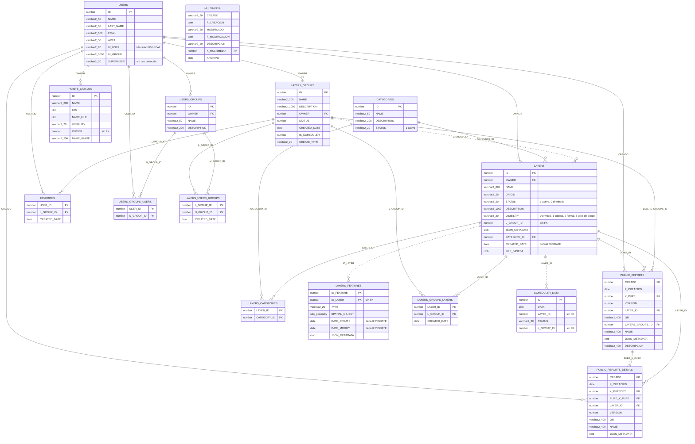

# Modelo de datos de SIATE y construcción en PostgreSQL

Modelo del esquema Oracle `SIANTE` y su construcción en PostgreSQL/PostGIS, para la prueba de concepto y el paso gradual de Oracle a PostgreSQL. Se armó **sin consultar la base**, a partir del diccionario de columnas que entregó el equipo.

## Fuentes

| Fuente | Qué aporta | Confiabilidad |
|---|---|---|
| `siate_.csv`: diccionario de columnas exportado de Oracle | Las 18 tablas: tipos, largos, nulabilidad, valores por defecto, claves primarias y claves foráneas | **Oficial** |
| Entidades JPA de siante2 (`adapter/out/oracle`) | Qué columnas usa siante2 y para qué | Código actual |
| Modelos y servicios del legacy (`siante/backend/src/siante`) | Cómo se relacionan las tablas sin clave foránea y qué significan los códigos | Inferido |

El CSV trae solo **tablas**. Las vistas (`V_*`, `NEXTVAL_*`), los triggers y las secuencias no vienen, así que su descripción sigue siendo inferida.

## Tablas

| Tabla | Columnas | La usa siante2 | Nota |
|---|---|---|---|
| `USERS` | 8 | Sí | `SUPERUSER` no está mapeada y el legacy no la usa |
| `CATEGORIES` | 4 | Sí | |
| `LAYERS` | 12 | Sí | `CREATED_DATE` no está mapeada |
| `LAYERS_FEATURES` | 7 | Sí | Clave primaria compuesta (ver hallazgos) |
| `LAYERS_CATEGORIES` | 2 | Sí | Clave primaria compuesta (ver hallazgos) |
| `LAYERS_GROUPS` | 8 | Sí | |
| `LAYERS_GROUPS_LAYERS` | 3 | Sí | |
| `FAVORITES` | 3 | Sí | |
| `POINTS_CATALOG` | 7 | Sí | |
| `SCHEDULER_DATA` | 5 | Sí | |
| `PUBLIC_REPORTS` | 10 | Sí | |
| `PUBLIC_REPORTS_DETAILS` | 9 | Sí | |
| `MULTIMEDIA` | 7 | Sí | |
| `USERS_GROUPS` | 4 | No | Grupos de usuarios. El código del legacy no las usa |
| `USERS_GROUPS_USERS` | 2 | No | Miembros de cada grupo de usuarios |
| `LAYERS_USERS_GROUPS` | 3 | No | Grupos de capas compartidos con grupos de usuarios |
| `PUBLIC_REPORTS_TEMPORAL` | 10 | No | Misma forma que `PUBLIC_REPORTS`, sin claves foráneas |
| `PARAMETROS` | 3 | No | Sin clave primaria |
| `MDRT_B4C74$` | 3 | — | Tabla interna del índice espacial de Oracle. **No se migra** |

## Diagrama entidad-relación

Línea continua: clave foránea que existe en Oracle. Línea punteada: relación **sin** clave foránea, inferida del legacy.

`PUBLIC_REPORTS_TEMPORAL` y `PARAMETROS` no aparecen en el diagrama porque no tienen relaciones.

**`L_GROUP_ID` es un grupo de capas.** Cada capa pertenece a un grupo (`LAYERS.L_GROUP_ID`, sin clave foránea). Los favoritos guardan el grupo, no la capa (`FAVORITES.L_GROUP_ID`, con clave foránea). Para listarlos, el legacy recorre `LAYERS_GROUPS_LAYERS`.

## Hallazgos

### Diferencias entre siante2 y la base (1 a 4 corregidas)
1. ✅ **`USERS.IV_USER` es `VARCHAR2(20)`**, pero `IdentidadWebSealFilter` aceptaba un `iv-user` de hasta 256 caracteres, que pasaba el filtro y fallaba al registrarse. **Corregido:** el filtro acepta hasta 20.
2. ✅ **`USERS.IV_GROUP` es `VARCHAR2(1000)`**, y el registro guardaba todos los grupos sin recortar. **Corregido:** se guardan los grupos que caben completos, con un aviso en el log. Los permisos no dependen de esta columna: salen de `iv-groups` en cada solicitud.
3. ✅ **`LAYERS_CATEGORIES` tiene clave primaria `(LAYER_ID, CATEGORY_ID)`**: una capa puede tener varias categorías. `CapaCategoriaEntity` declaraba solo `layerId`, y Hibernate habría descartado categorías sin aviso. **Corregido:** clave compuesta.
4. ✅ **`LAYERS_FEATURES` tiene clave primaria `(ID_FEATURE, ID_LAYER)`**, y SIATE numera `ID_FEATURE` dentro de cada capa, así que se repite entre capas. `ElementoCapaEntity` declaraba solo `idFeature`. **Corregido:** clave compuesta.

`EntidadesSiateTest` compara ahora la clave primaria de cada entidad con la de Oracle, y las pruebas de `USERS` usan los largos reales.
5. **Columnas no mapeadas:** `LAYERS.CREATED_DATE` (con `SYSDATE` por defecto) y `USERS.SUPERUSER`. Al escribir una capa, la fecha la pone Oracle. `SUPERUSER` no la usa nadie conocido.

### Características del esquema
6. **Claves foráneas que faltan en Oracle:** `LAYERS.L_GROUP_ID`, `LAYERS_FEATURES.ID_LAYER`, `POINTS_CATALOG.OWNER`, `SCHEDULER_DATA.*` y todo `PUBLIC_REPORTS_TEMPORAL`. Puede haber datos huérfanos.
7. **Los IDs no tienen valor por defecto** en el diccionario: los ponen triggers o secuencias, que no vienen en el CSV.
8. **`MULTIMEDIA.DESCRIPCION` es `VARCHAR2(20)`**: descripciones muy cortas para títulos de manuales y guías.
9. **Códigos guardados como texto:** `STATUS` y `VISIBILITY` son `VARCHAR2(20)` en `LAYERS`, pero `STATUS` es `NUMBER` en `LAYERS_GROUPS`.
10. **Cinco tablas sin uso en el código del legacy** (`USERS_GROUPS`, `USERS_GROUPS_USERS`, `LAYERS_USERS_GROUPS`, `PUBLIC_REPORTS_TEMPORAL` y `PARAMETROS`): puede ser funcionalidad abandonada o algo que usa otro sistema.

## Construcción en PostgreSQL: dos pasos

### Paso 1 · Espejo fiel de Oracle → [`V1__esquema_espejo.sql`](../backend/src/test/resources/db/postgresql/V1__esquema_espejo.sql)
**Generado automáticamente desde el CSV:** 18 tablas, 107 columnas, las 20 claves foráneas de Oracle y 17 índices. Mantiene los mismos nombres, largos, nulabilidad y claves que Oracle, para que la carga inicial y la réplica (fases 1 a 3 del plan) copien los datos sin transformarlos.

| Oracle | PostgreSQL | Regla |
|---|---|---|
| `NUMBER` (clave primaria simple) | `integer generated by default as identity` | Reemplaza al trigger; "by default" admite cargar los IDs de Oracle |
| `NUMBER` | `integer`; `NUMBER(1,0)` → `smallint` | |
| `VARCHAR2(n)` | `varchar(n)` | Mismo largo |
| `CLOB` | `text` | `jsonb` recién en el paso 2 |
| `BLOB` | `bytea` | No `oid` |
| `DATE` | `timestamp(0)` | `DATE` de Oracle incluye hora, sin fracciones |
| `DEFAULT SYSDATE` | `default localtimestamp(0)` | |
| `SDO_GEOMETRY` | `geometry(Geometry, 4326)` + índice GiST | SRID por confirmar |

Índices agregados que Oracle tiene implícitos o que PostgreSQL no crea solo:
- en cada columna con clave foránea que no encabeza la clave primaria;
- en `layers_features.id_layer`, que se usa para abrir una capa;
- un índice GiST en `spatial_object`.

**Verificado** en un PostGIS 18 / 3.6 desechable en Docker:
- el script se aplica sin errores;
- los ID salen por `identity` y las fechas por defecto se llenan;
- una geometría GeoJSON entra y sale con SRID 4326;
- las claves foráneas rechazan un favorito a un grupo inexistente;
- `iv_user` de 21 caracteres se rechaza, igual que en Oracle;
- la búsqueda por zona (`&&`) usa el índice GiST.

### Paso 2 · Mejoras (al dejar Oracle como base principal)
Se aplican con migraciones Flyway **después** del cambio de escritura (fase 3), cuando PostgreSQL ya no necesite ser idéntico a Oracle:

| Mejora | Antes de aplicarla |
|---|---|
| `JSON_METADATA` y `DATA` → `jsonb`, con índices GIN si hacen falta | Validar que **todas** las filas sean JSON válido; las que no, corregirlas o separarlas |
| `STATUS` y `VISIBILITY` → `smallint` con `check` | Revisar que solo existan los valores conocidos |
| Agregar las claves foráneas que faltan (hallazgo 6) | Limpiar huérfanos, o agregarlas como `not valid` y validarlas después |
| Ajustar las secuencias de `identity` al ID máximo | Obligatorio en el momento del cambio, antes de la primera escritura |
| Quitar `''`: Oracle guarda la cadena vacía como `NULL` y PostgreSQL no | Convertir `''` a `NULL` en la carga, o dejar las consultas listas para ambos casos (hoy usan `coalesce`) |
| Eliminar las tablas sin uso (hallazgo 10) | Confirmar que ningún sistema las usa |

**Formato de `jsonb`:** PostgreSQL reordena las claves y quita espacios. El contenido es el mismo, pero si alguna parte compara el JSON como texto, debe dejar de hacerlo.

## Vistas (no vienen en el CSV)

| Vista | Qué entrega (inferido) | Propuesta en PostgreSQL |
|---|---|---|
| `V_LAYERS` | `LAYERS` + dueño (`USERS`) + nombre de categoría | Vista con `join`, o consulta JPQL directa |
| `V_LAYERS_GROUPS` | `LAYERS_GROUPS` + cantidad de capas | Vista con `count(*)` sobre `LAYERS_GROUPS_LAYERS` |
| `V_LF_TYPE_FILTER` | Elementos filtrados por tipo, para la intersección | Vista sobre `LAYERS_FEATURES`; filtro por confirmar |
| `V_SELECT_AREA` | Capas elegibles para la selección por área | Vista o consulta directa |
| `V_MEASURE_DISTANCE` | Distancia entre elementos de dos capas | **Función** con `ST_Distance` y parámetros: como vista sin filtro es un producto cartesiano |
| `NEXTVAL_PUBLIC_REPORTS(_DETAILS)` | El siguiente correlativo | Las columnas `identity` de `x_pure` y `x_puredet`; desaparecen |

Las vistas que usa siante2 hoy (`V_LAYERS` y `V_LAYERS_GROUPS`) se agregan al espejo en cuanto el DBA entregue su definición SQL. Las de análisis se definen cuando esas herramientas tengan ticket.

## Lo que Hibernate genera mal

Si PostgreSQL se creara con el DDL que Hibernate genera desde las entidades actuales:

| Columna | Hibernate genera | Problema |
|---|---|---|
| `JSON_METADATA`, `DATA` | `varchar(255)` | **Trunca** el JSON |
| `MULTIMEDIA.ARCHIVO` | `oid` | Objeto grande aparte, que no se borra solo |
| IDs (salvo `USERS`) | `integer` sin `identity` | Las escrituras no tendrían ID |
| `LAYERS_CATEGORIES`, `LAYERS_FEATURES` | Clave primaria de una columna | No coincide con Oracle (hallazgos 3 y 4) |
| Vistas `V_*` | `create table` | Hibernate no distingue una vista |

Por eso **el esquema de PostgreSQL lo maneja Flyway** (partiendo de `V1__esquema_espejo.sql`), nunca `ddl-auto`. Las entidades de PostgreSQL, en su propio adaptador (`adapter/out/postgres`), llevan `@JdbcTypeCode(SqlTypes.JSON)` para `jsonb` (paso 2) y `SqlTypes.VARBINARY` para `bytea`.

## Prueba de concepto: los adaptadores de hoy sobre PostgreSQL

`mvnw test -Ppostgres` levanta PostGIS 18 / 3.6 con Testcontainers. Flyway aplica [`V1__esquema_espejo.sql`](../backend/src/test/resources/db/postgresql/V1__esquema_espejo.sql) y [`V2__vistas_inferidas.sql`](../backend/src/test/resources/db/postgresql/V2__vistas_inferidas.sql), y se prueban los **adaptadores de Oracle sin cambios**. Todo queda en los tests: la aplicación sigue usando solo Oracle.

| Qué se prueba | Resultado |
|---|---|
| Tablas, columnas y claves primarias de las entidades (`EsquemaPostgresTest`) | ✅ Todas, salvo las 3 vistas de análisis, que no tienen definición |
| Geometría PostGIS en SRID 4326, con índice GiST | ✅ |
| Usuarios: alta con ID por `identity` y búsqueda | ✅ Sin cambios |
| Categorías activas | ✅ Sin cambios |
| Mis capas y abrir una capa desde `v_layers`, con el mismo `ID_FEATURE` en dos capas y capas por URL | ✅ Sin cambios |
| Capa con `JSON_METADATA = ''` (Oracle lo guarda como `NULL`) | ✅ Sin cambios |
| Correlativos de reportes (`nextval_public_reports` sobre la secuencia de `identity`) | ✅ Sin cambios |
| Multimedia: leer `ARCHIVO` | ❌ **Brecha:** con `@Lob`, Hibernate lo lee como `oid` y en PostgreSQL es `bytea`. Se resuelve en el adaptador de PostgreSQL (`@JdbcTypeCode(SqlTypes.VARBINARY)`); el test queda `@Disabled` hasta entonces |

**Conclusión:** con el esquema espejo, casi todo el acceso a datos actual funciona igual en PostgreSQL. Las brechas concretas son la multimedia (`bytea`), las vistas de análisis sin definir y las vistas `v_layers` / `v_layers_groups`, que hoy son inferidas. Falta todavía la escritura de geometrías (`GeometriaAWkt` usa `SDO_UTIL`), que se probará cuando haya escrituras (SIS-201-b).

## Pendientes para el DBA
1. Definición SQL de las vistas `V_LAYERS`, `V_LAYERS_GROUPS`, `V_LF_TYPE_FILTER`, `V_SELECT_AREA` y `V_MEASURE_DISTANCE`.
2. Triggers y secuencias de los IDs.
3. SRID de `LAYERS_FEATURES.SPATIAL_OBJECT` (se asume 4326) y cuántas geometrías no son válidas.
4. Si otro sistema usa las 5 tablas sin uso conocido y `USERS.SUPERUSER`.
5. Volumen: filas por tabla y tamaño de los `CLOB`/`BLOB`, para dimensionar PostgreSQL y la carga inicial.
6. Valores de `CREATE_TYPE`, `ORIGIN` y `SCHEDULER_DATA.STATUS`.
